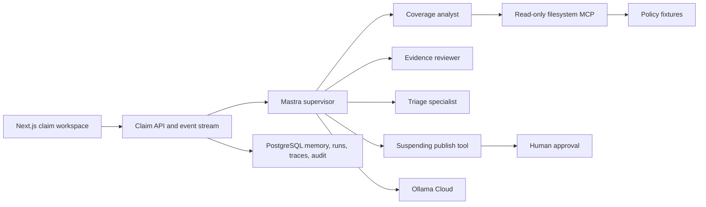

# ClaimLens AI

Provisional delayed-baggage claim triage for the Collinson Senior AI Engineer
take-home. The system demonstrates Mastra supervisor/sub-agent delegation,
least-privilege tools, a working filesystem MCP server, durable human approval,
behavioral evaluation, and an accessible split workspace.

This is **not** claim adjudication. A claims handler must approve, request
changes, or decline every published result.

## Run

```bash
cp .env.example .env
make setup
make docker-up
```

Open [http://localhost:3000](http://localhost:3000).

Without Docker:

```bash
make setup
make dev
```

If `DATABASE_URL` is unset, claim state stays in process memory. Docker Compose
uses PostgreSQL and persists claim, approval, and audit records.

### Model configuration

| Variable | Purpose |
| --- | --- |
| `CLAIMLENS_AGENT_MODE` | `fake` (default, deterministic) or `live` |
| `OLLAMA_API_KEY` | Ollama Cloud key, server-side only |
| `OLLAMA_BASE_URL` | Defaults to `https://ollama.com/v1` |
| `OLLAMA_MODEL` | Required in live mode, for example `gpt-oss:120b` |

Live mode is never enabled just because a key exists. Set
`CLAIMLENS_AGENT_MODE=live` explicitly.

Ollama Cloud does not currently guarantee structured-output mode. Live runs
validate model payloads with Zod and escalate if a repair still fails.

## Verify

```bash
make eval            # deterministic behavioral suite, no API key
make test            # unit tests in Docker
make typecheck
make lint
make eval-live       # checks Ollama key/model configuration
make verify          # lint, typecheck, tests, evals
```

`make test-e2e` runs the Playwright approval path against a local Next server.

## Architecture



### Agent and tool boundaries

- **Supervisor** builds a compact case brief, delegates, and calls `publish-triage`. It cannot read policy files.
- **Coverage Analyst** receives only read-only MCP list/search/read tools.
- **Evidence Reviewer** receives the deterministic evidence checklist tool.
- **Triage Specialist** reconciles structured findings and has no policy or publish tool.
- **publish-triage** suspends the run until a handler approves, requests changes, or declines.

Events sent to the browser are sanitized lifecycle, tool, citation, approval, and
token-usage records. Hidden chain-of-thought is not exposed.

### Memory, summarization, middleware, HITL

- Claim-scoped Mastra memory with a short recent-message window.
- Specialists receive the case brief rather than the raw form notes.
- Input processors redact obvious PII/secrets and apply a token limiter.
- High-impact results suspend for human approval. The run id is stored so the
  decision can be applied after a restart.

## Evaluation

Deterministic scorers in `evals/cases/` check:

- classification vs policy/evidence rules
- required and forbidden tools
- specialist delegation
- approval suspension
- MCP and malformed-output degradation
- PII leakage in sanitized events

They do not score prose quality. `make eval-live` only verifies that live model
configuration is present.

## Demo

1. Load the covered example and run triage.
2. Watch Coverage, Evidence, and Triage appear in the trace with token counts.
3. Approve with a note. Reload to confirm the decision persisted when Postgres is enabled.
4. Load the missing-receipts example. The result should be `needs review`, not a denial.
5. Submit policy number `CL-MCP-001` to see a typed policy-unavailable failure.

## Assumptions and limits

- One delayed-baggage policy fixture, metadata-only evidence, no uploads or OCR.
- No authentication, payout calculation, or insurer integration.
- Filesystem MCP is restricted to `fixtures/policies`.
- Postgres data lives in the `claimlens-data` volume; back it up before destroying Compose state.
- The assessment PDF is gitignored and is not part of the repository.

## Production follow-ups

Add identity, authorization, encrypted document storage, policy versioning,
distributed run execution, secret management, retention, high-volume
observability, and independent model-risk review before handling real claims.
