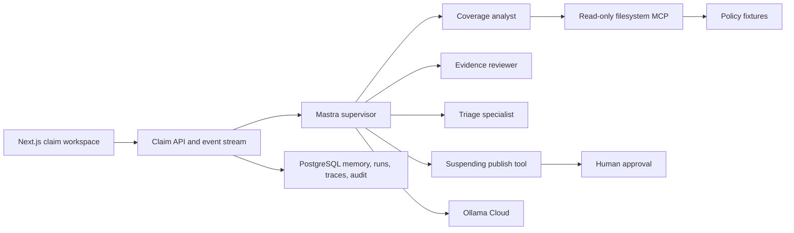

# ClaimLens AI Design and Implementation Plan

## Goal

Build a Dockerized delayed-baggage claim triage application that demonstrates
supervisor-led multi-agent delegation, least-privilege tools, a working external
MCP server, durable human approval, behavioral evaluation, and an accessible
modern interface.

The system provides provisional triage only. It does not adjudicate claims,
calculate payouts, or replace a human claims handler.

## Product Scope

### Included

- One delayed-baggage policy and claim workflow
- Coverage, evidence, and triage specialist agents
- A Mastra supervisor agent
- Read-only policy access through the official filesystem MCP server
- Ollama Cloud models configured entirely on the server
- PostgreSQL-backed claim state, memory, traces, and approval audit
- Bounded memory for clarification turns
- Structured case-brief summarization between agents
- Human approval before publishing high-impact or low-confidence outcomes
- Token usage, latency, delegation, and tool events in the UI
- Deterministic tests and live behavioral evaluations

### Deliberately Excluded

- Authentication and real customer accounts
- Document uploads, OCR, and image analysis
- Multiple policy products
- Payout calculation or automated adjudication
- Live insurer or airline integrations
- Horizontal scaling and deployment automation

## Architecture

Use one TypeScript/Next.js application so the React UI, server routes, and
Mastra orchestration ship in one image. Keep domain, AI, persistence, API, and
UI modules separate under `src/`.

Run PostgreSQL as the second Compose service for Mastra memory and observability
plus application claim and approval records. Launch the official filesystem MCP
server as a restricted child process inside the application container with only
`fixtures/policies/` mounted read-only.

Configure Ollama Cloud with `OLLAMA_API_KEY`,
`OLLAMA_BASE_URL=https://ollama.com/v1`, and `OLLAMA_MODEL`. Because Ollama
Cloud does not currently guarantee structured-output mode, validate every model
result with Zod, attempt one constrained repair, and otherwise escalate safely.

## Agent and Tool Boundaries

- **Supervisor:** validates and summarizes the claim, delegates work, reconciles
  results, and invokes publication. It cannot read policy files directly.
- **Coverage Analyst:** receives only the compact case brief and read-only MCP
  list/search/read tools. It must cite policy clauses.
- **Evidence Reviewer:** receives claim evidence metadata and deterministic
  checklist tools. It cannot access policy files.
- **Triage Specialist:** combines validated specialist results into `likely
  covered`, `needs review`, or `insufficient information`. It has no policy or
  publication tool.
- **Publication tool:** suspends low-confidence and `likely covered` results for
  approve, request-changes, or decline actions and records an immutable audit
  event when resumed.

No hidden chain-of-thought is exposed. The browser receives sanitized lifecycle,
delegation, tool, approval, latency, citation, and token-usage events.

## Data, Safety, and Failure Handling

- Zod schemas define all trust boundaries and agent handoffs.
- Obvious contact and payment identifiers are masked before model calls.
- Memory is claim-scoped and bounded; specialists receive role-filtered context.
- Policy paths are constrained both by MCP allowed roots and a read-only mount.
- Model, MCP, database, timeout, malformed-output, and disconnect errors map to
  typed recoverable states.
- Missing policy verification never becomes a coverage denial.
- API requests carry correlation IDs and idempotency keys.
- Suspended run IDs and approval notes survive application restarts.

## User Experience

The responsive split workspace places the claim form and provisional result on
the left and the execution trace on the right. It includes evidence and citation
cards, agent and tool statuses, token and latency summaries, recoverable error
states, and approval controls.

The visual system uses IBM Plex Sans, semantic security-blue and protected-green
tokens, restrained motion, visible focus, high contrast, and responsive stacking.
It avoids generic purple AI gradients. The interface supports keyboard use,
screen readers, reduced motion, and clear linked validation errors.

## Evaluation Strategy

Deterministic scorers evaluate behavior rather than only final prose:

- Correct agent delegation
- Required, forbidden, and ordered tool calls
- Tool argument validity
- Policy clause citation
- Triage-rule consistency
- Approval suspension and resumption
- PII leakage
- Token budgets
- MCP and model failure degradation

Versioned cases cover likely coverage, exclusions, missing evidence, ambiguity,
prompt injection, MCP failure, malformed model output, and human approval.
Keyless tests use fake model adapters; `make eval-live` is the only command that
requires Ollama credentials.

## Build Sequence and Commit History

0. `docs: add ClaimLens AI implementation plan`
1. `chore: scaffold dockerized TypeScript application`
2. `feat: define claim triage domain and fixtures`
3. `feat: persist claim memory and audit state`
4. `feat: integrate read-only policy MCP server`
5. `feat: add supervised claim triage agents`
6. `feat: add durable human approval workflow`
7. `feat: build claim triage and agent trace workspace`
8. `test: add behavioral agent evaluation suite`
9. `docs: document architecture evaluation and operations`

Each milestone must remain runnable and pass its relevant checks before commit.
Behavioral code follows a red-green-refactor cycle.

## Verification Contract

- `make setup` creates local configuration without committing secrets.
- `make dev` and `make docker-up` provide equivalent development paths.
- `make lint`, `make typecheck`, `make test`, `make test-integration`,
  `make test-e2e`, and `make eval` are deterministic and keyless.
- `make eval-live` verifies Ollama model and tool compatibility.
- `make verify` runs every keyless quality gate.
- The final smoke test submits a claim, observes delegation and policy MCP calls,
  inspects usage, suspends for approval, resumes, and reloads the persisted result.

## Production Follow-ups

Add identity and authorization, encrypted object storage, malware scanning and
OCR, policy versioning, insurer integrations, distributed run execution,
centralized secret management, retention controls, high-volume observability,
and independent security and model-risk reviews before handling real claims.
